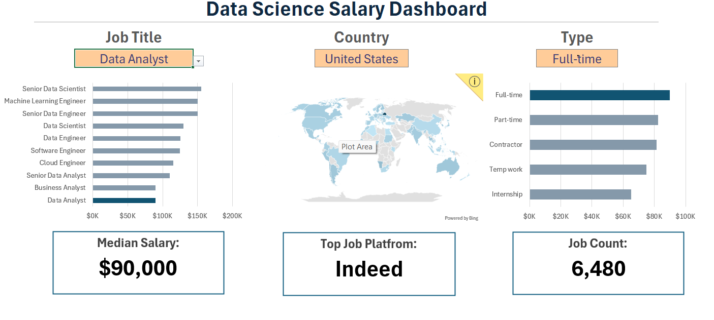

# Project 2: Data Science Salary Dashboard

## About This Project

I built this interactive dashboard in Excel to explore salaries across 32,672 data-related job postings, covering 10 job titles, 111 countries, and 593 job platforms. Pay for these roles varies by title, location, and employment type, so I wanted one place where a reader can filter the data and see the answer immediately.

The dashboard has three dropdown filters: job title, country, and employment type. For any combination, it shows the median yearly salary, the number of matching postings, and the top job platform. Three charts show median salary by job title, by employment type, and by country (map), and the selected item is highlighted in the bar charts.

## How I Built It

I stored the data in an Excel Table and used dynamic array functions (`UNIQUE`, `SORT`, `FILTER`, `XLOOKUP`) to generate the dropdown lists. I calculated medians with `MEDIAN(IF(...))` and counts with `COUNTIFS`, then linked everything to the dashboard through named ranges and data validation.

**Default view (Data Analyst, United States, Full-time):** median salary $90,000, 6,480 postings, top platform Indeed.

**Tool:** Microsoft Excel
**File:** [Project2 dashboard.xlsx](Project2%20dashboard.xlsx)
